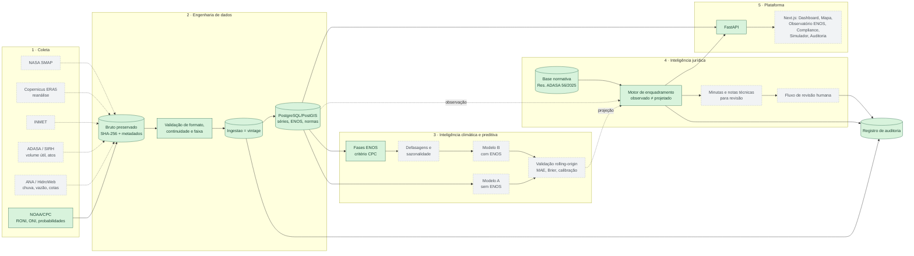

# Arquitetura — Aqua Foresight

Referência: *Aqua Foresight — Especificação de Projeto v2.0* (10/11/2026). Este documento separa **[ESPEC]** (definido na especificação) de **[IMPL]** (decisão desta implementação).

## 1. Visão geral

[ESPEC] Modelo 4C (Coleta → Cálculo → Compliance → Concretização) com camada transversal ENOS + proveniência + auditoria. A IA é apoio à decisão, nunca autoridade.

[IMPL] Monólito modular em Python (um pacote, módulos por camada) com FastAPI e PostgreSQL/PostGIS. Microsserviços, filas e orquestradores ficam fora do MVP; o agendamento começa por cron e só migra para Prefect quando houver ≥3 fontes com cadências diferentes.

Verde = implementado e testado; cinza tracejado = planejado.

## 2. Banco de dados

[ESPEC §5.1] FonteDado, SerieObservada, IndiceENOS, Previsao, RegraJuridica, EventoRisco, AcaoRecomendada.

[IMPL v0.1] Implementadas: `fonte_dado`, `ingestao`, `indice_enos`, `reservatorio`, `serie_observada`, `norma_juridica`, `limiar_estado_hidrologico`, `registro_auditoria`. Ajustes em relação à especificação:

- **`ingestao` como vintage.** Toda linha de dado referencia a carga que a trouxe. Revisões retroativas da fonte criam linhas novas em vez de sobrescrever — permite reconstruir o que se sabia em qualquer data (`vintage_vigente(ate=...)`) e impede vazamento temporal na validação (risco listado na §12 da especificação). Conteúdo idêntico (mesmo SHA-256) não duplica.
- **`RegraJuridica` dividida** em `norma_juridica` (ato, publicação, fontes, vigência, status de verificação) e `limiar_estado_hidrologico` (reservatório × mês × estado × limite). Regras de outros tipos (outorga, suspensão, competências) entrarão como tabelas próprias quando forem modeladas.
- **`natureza`** explícita: `observado`, `estimado_provisorio`, `projetado`, `sintetico`.
- `Previsao`, `EventoRisco`, `AcaoRecomendada` e geometrias PostGIS entram nas fases 4–6.

Dicionário essencial:

| Tabela.campo | Significado |
|---|---|
| fonte_dado.status_conector | `nao_verificado` até um download bem-sucedido; `falha` após erro (RF-05) |
| ingestao.sha256 / caminho_bruto | Checksum e local do arquivo bruto preservado |
| ingestao.sintetico | Carga de teste/demonstração; excluída por padrão das consultas |
| indice_enos.ano, estacao, mes_central | Convenção CPC: DJF/2026 → mês central jan/2026 |
| indice_enos.periodo_base | Base de anomalias (RONI: 1991–2020, informada pelo CPC) |
| limiar_estado_hidrologico.limite_pct, comparador | % do volume útil, comparação estrita `<` (Tabela 1) |
| norma_juridica.status_verificacao | `nao_verificado` → `tabela_conferida_fonte_oficial` → `revisado_assessoria_juridica` |
| norma_juridica.vigencia_status | `a_conferir` até revisão jurídica; o motor emite ressalva enquanto não for `conferida` |

Migrações: hoje `create_all`; Alembic é a próxima tarefa de infraestrutura (antes do primeiro banco compartilhado).

## 3. Mapa de integrações externas

| Fonte | Variáveis | Acesso | Situação |
|---|---|---|---|
| NOAA/CPC RONI | Índice ENOS operacional (desde 01/02/2026) | Arquivo texto público: `https://www.cpc.ncep.noaa.gov/data/indices/RONI.ascii.txt` (URL confirmada no aviso NWS PNS 26-05) | Adaptador pronto; download real **não verificado** |
| NOAA/CPC ONI (legado) | ONI clássico | `.../data/indices/oni.ascii.txt` | Adaptador pronto; não verificado |
| NOAA/CPC Rnino34 | Niño 3.4 relativo mensal | `.../data/indices/Rnino34.ascii.txt` | A implementar |
| NOAA/CPC probabilidades ENSO | Cenários para 90 dias | A localizar formato estruturado | A investigar |
| ADASA | Volume útil Descoberto/Santa Maria, estados hidrológicos, atos | A investigar (SIRH; a Res. 56/2025 prevê divulgação de estados, curvas e volumes observados em um sistema de informação — nome a confirmar no texto integral) | A investigar |
| ANA / HidroWebService | Cota, vazão, chuva telemétricas | API com credencial (e-mail a hidro@ana.gov.br); token por cabeçalhos Identificador/Senha, validade 60 min | Cliente implementado e testado com servidor simulado; não verificado com credencial |
| ANA / SAR, módulo DF | Cota, volume (hm³) e % de Descoberto e Santa Maria, diário desde 1990 (esparso no início) | API não documentada `https://www.ana.gov.br/sar/restportal/api/retornaMedicoes` (data MM/dd/yyyy, tipoSistema=4) e `retornaGrafico?codigo=40001/40002`, achada no código do portal | **Em produção** (carga histórica + atualização diária); Descoberto convertido para base ADASA (estimado) |
| ADASA / SIRH-DF (gis.adasa.df.gov.br) | Série oficial de volume útil | Portal ArcGIS | Inacessível a partir do GitHub Actions (timeout de conexão); fonte oficial para validar a conversão |
| INMET | Precipitação, temperatura | A investigar | — |
| Copernicus ERA5 | Reanálise | API CDS com conta | — |
| NASA SMAP | Umidade do solo | Earthdata com conta | — |
| AEMET / MITECO | Módulo Espanha | Fase 7 | — |

Nenhum endpoint além dos do CPC foi confirmado nesta versão; os demais não devem ser codificados antes de verificação.

## 4. Estratégia de modelagem do ENOS

1. **Índice principal:** RONI (o CPC passou a usá-lo no sistema de alerta ENSO em 01/02/2026); ONI legado mantido para continuidade e sensibilidade.
2. **Valores recentes provisórios:** o CPC informa que podem mudar por até dois meses; as duas últimas estações de cada carga são marcadas `estimado_provisorio`, e o histórico de vintages permite treinar só com o que estava disponível na data de emissão.
3. **Fase vs. impacto:** a fase (El Niño/La Niña/neutro) descreve o Pacífico; a relação com o DF é **hipótese H1/H2**, a ser testada: defasagens de 0–12 meses contra anomalias de chuva/vazão/volume, controlando sazonalidade e autocorrelação, por estação do ano.
4. **Experimento A × B:** mesmo modelo e mesmos dados locais, com e sem variáveis ENOS; validação rolling-origin; métricas por horizonte (30/60/90 dias) e por estação; relatar quando o ENOS melhora, não muda ou piora. Resultado nulo é resultado válido.

## 5. Integração previsão ↔ regras jurídicas

O motor (`legal/enquadramento.py`) recebe um valor de volume útil com `natureza` explícita:

- **observado** → `encaminhamento_para_analise` com estado indicativo, limiares do mês, dispositivo e fontes;
- **projetado** → no máximo `alerta_antecipatorio`; a condição de uso é rotulada como "se confirmada em observação oficial";
- **sem limiar / valor inválido / data inconsistente** → `bloqueado` + `revisao_humana_obrigatoria`.

Sempre: `acoes_automaticas = []`, `requer_revisao_humana = true`, aviso de que não é ato administrativo, registro em auditoria. Quando houver modelo validado, cada quantil/probabilidade da previsão será avaliado contra os limiares do mês de destino (D+30/60/90), e a probabilidade de cruzamento — não o rótulo do estado — alimentará o alerta.

Fora do escopo atual: regras de saída de estado (permanência mínima prevista na norma), que exigem histórico e leitura jurídica do texto integral.
